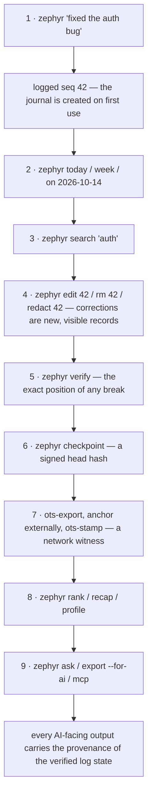

# Features and current behavior

Every feature that exists in `zephyr 0.2.0` (format v1), what it does, and
how it behaves today. Byte-level contracts live in `spec/`; this document
describes the behavior a user or an AI will observe.

## Capture

**Quick log** — `zephyr "text"` and `zephyr log [-t TAG]... "text"`

- Creates the journal on first use; no setup, no required fields.
- Verifies the existing journal before appending — a broken journal is
  refused, never extended (`FAIL: …` line on stderr, exit 1).
- The wall clock supplies UTC milliseconds plus the local timezone offset;
  text is NFC-normalized UTF-8; tags are optional.
- Prints `logged seq N`, where N is the new record's sequence number.
- A bare word is a quick log: `zephyr fix the bug` logs `fix the bug`.

**Amend** — `zephyr edit <seq> [-t TAG]... "text"`

- Appends an *amendment* record pointing at the target; the original stays
  in the log. Prints `amended seq N (new seq M)`.
- The entry's tags are carried over unless `-t` is given, so a plain text
  edit never silently drops tags.

**Hide** — `zephyr rm <seq>`

- Appends a *tombstone*; the entry disappears from views, search, exports,
  and the MCP server, but its bytes remain in the file. Prints
  `tombstoned seq N (new seq M)`.

**Redact** — `zephyr redact <seq> [--yes]`

- The only operation that removes content from disk: the entry's text,
  tags, and salt are physically erased from the payload region. The header
  and its salted commitment are kept, so the chain still verifies and the
  redaction is visible. A signed `redaction` record is appended.
- Prompts once on stdout — `redact seq N? … Proceed? [y/N]` — and reads one
  line from stdin; anything other than `y`/`Y` prints `aborted` and does
  nothing. `--yes` skips the prompt.
- Prints `redacted seq N (redaction seq M)`. Redacted entries show as
  `[redacted]` in views; `verify` reports the count, not a failure.

## Views and search

**Period views** — `zephyr today | yesterday | week | on YYYY-MM-DD`

- Civil days are computed in the journal's local timezone; `week` is the
  ISO Monday–Sunday week containing today.
- Rendered by the deterministic view renderer: a provenance line
  (`# zephyr: seq 0..N head=HEX`), one date header per day
  (`# YYYY-MM-DD Mon`), then entry lines `HH:MM [tag] text` — with `(edited)`
  marking an amended entry and `[redacted]` marking a redacted one.
- Latest amendment text is what's shown; tombstoned entries are omitted;
  private entries never appear.

**Keyword search** — `zephyr search "query"`

- Case-insensitive substring match over the *effective* text — what the
  view shows — of visible entries (non-private, non-tombstoned,
  non-redacted). Superseded original text of amended entries is not
  searched. Results are in view order, each on one view line.

**Export** — `zephyr export --for-ai [YYYY-MM-DD[:YYYY-MM-DD]]`

- The LLM view of the whole log (or an inclusive range). Refuses to render
  a failing log (reports the exact position, exit 1). On the gate profile
  it measures 8.80 tokens/entry against a ≤ 9.0 target.

## Trust layer

**Verify** — `zephyr verify`

- Re-reads every segment, re-walks the hash chain, checks sealed footers,
  and reports the exact failing record/field/detail on stderr (exit 1).
- On success: `ok: N record(s), head HEX` (plus `, K redacted` when there
  are redactions).
- If a checkpoint anchor exists, it is checked: the anchor must be a valid
  190-byte signed artifact whose checkpoint is present and whose head/count
  the current log must at least match (truncation and record removal fail
  it). Prints `anchor: ok (checkpoint seq N, head HEX)`.
- Every stored OpenTimestamps proof is re-verified against its segment's
  footer head. Prints one `ots: ok (ots-YYYY-MM.ots, attested at …)` line
  per proof. Any failure exits 1.

**Checkpoint** — `zephyr checkpoint [--key PATH]`

- Appends a `checkpoint` record, re-verifies, and writes a 190-byte
  Ed25519-signed anchor `anchors/checkpoint-<seq>.zpa` binding the log's
  head hash and record count. Prints
  `checkpoint seq N (key PATH, anchor anchors/checkpoint-N.zpa)`.
- Key resolution: `--key PATH` > `$ZEPHYR_KEY` > `<journal>/zephyr-key`.
  The default key is a 32-byte CSPRNG seed created 0600 on first use; the
  key pair is derived deterministically from it, so the key file is the
  only secret.

**OpenTimestamps** — `zephyr ots-export <segment> [--out PATH]` and
`zephyr ots-stamp <segment> --proof PATH`

- Segments seal when the next month's segment is first written; only sealed
  segments can be stamped.
- `ots-export` writes the segment's 32-byte footer head (default
  `<cwd>/<segment>.head`): `ots-export: wrote PATH (head HEX); anchor this
  file to get an .ots proof`.
- `ots-stamp` takes a standard OpenTimestamps v1 detached proof (sha256
  over the head), verifies it, stores it as `anchors/ots-<YYYY-MM>.ots`,
  and prints `ots-stamp: ok (anchors/ots-YYYY-MM.ots, attested at bitcoin
  height N)` (or the pending-calendar URI). A bad proof is rejected with a
  specific reason (exit 1).
- `verify` re-checks every stored proof on every run, so a segment edited
  after stamping is caught.

## AI access

**MCP server** — `zephyr mcp [--allow-write]`

- Speaks MCP over stdin/stdout. Read-only by default; `--allow-write`
  enables `add_entry`.
- Tools: `get_entries` (period), `search`, `get_digest` (period; defaults
  to the current week), `get_profile`, `verify_status`, `get_context`
  (question + optional range — the same pack `ask` prints), and `add_entry`.
- Verify before trust: a failing journal is reported as an error result
  (`isError=true`), never served silently. Every successful result begins
  with the provenance line of the verified log state it was read from.

**Context pack** — `zephyr ask [from:to] <question...>`

- Deterministic and offline: provenance, the question, the derived
  profile, `notes.md`, the period digest, and the matching entries.
- Retrieval is hybrid (keyword + vector RRF) when the embedding artifact is
  fresh and the model loads; **any** failure degrades silently to the
  keyword list. `ask` never fails over embeddings.

**Rank** — `zephyr rank <query...> [--mode keyword|vector|hybrid] [--top N]`

- Ranked retrieval: `keyword` (token hits), `vector` (cosine top-N over the
  fresh artifact), `hybrid` (reciprocal-rank fusion of the two — the
  default). N defaults to 10.
- Output: a provenance line, then one line per hit —
  `rank⇥seq⇥score (6 decimals)⇥view line`.
- `vector`/`hybrid` need a fresh embedding artifact and the model; without
  them they print an actionable line on stderr and fail with
  `EmbeddingsUnavailable`. `keyword` needs only the journal.

## Derived layer

Everything derived is a pure function of the verified log, records the log
state it came from, and is safe to delete — deleting it loses nothing.

**Profile** — `zephyr profile` prints the derived profile plus `notes.md`.
The profile is `profile.md` (`# zephyr-profile: v1 range=… head=…`); it is
rebuilt from the log when stale. `notes.md` is the user's own file and is
never rewritten by zephyr.

**Status** — `zephyr derived status` lists each artifact — `index`,
`profile`, `embed`, and every stored digest — with its state
(`fresh`/`stale`/`corrupt`/`missing`) and the head it is bound to. The
embedding line additionally shows the dimension, the model hash, and the
engine id.

**Rebuild** — `zephyr derived rebuild [--embeddings]` force-rewrites the
index (`derived/index.zdi`) and the profile; digests regenerate on demand.
`--embeddings` also (re)builds the vector artifact `derived/embed.zde` —
this loads the model and embeds every visible entry, so it takes a while
and is the only way to refresh the artifact (a new entry or a different
model makes it stale; the commands that need it then refuse and say to run
this).

**Digests** — period summaries (`derived/digests/<start>_<end>.digest`),
rendered on demand by `recap` and `ask`; the AI reads a digest first and
drills into raw entries only when needed.

**Recap** — `zephyr recap [start..end]` prints the period digest (default:
the current week, Monday–Sunday).

## Semantic search (Phase 8)

- The model is **EmbeddingGemma-300M, Q8_0** — a small embedding model that
  runs fully locally: 328,577,056 bytes, SHA-256
  `a0f7b4e13c397a6e1b32c2de75b1f65a14c92ec524d5f674d94a4290a1c4969b`,
  downloaded once to `~/.zephyr/models/embeddinggemma-300M-Q8_0.gguf`
  (or pointed at with `$ZEPHYR_EMBED_MODEL`).
- llama.cpp is linked as a native static library from a pinned submodule
  (b11609); the model is loaded once per process and batched. Metal on
  macOS, CPU elsewhere. The build can skip the engine entirely
  (`zig build -Dno-embed=true`); then the vector surface reports
  `EngineUnavailable`.
- The artifact (`derived/embed.zde`, ZDE1) stores per-entry vectors with
  the log head, the model hash, and the engine id; a mismatch of any of
  the three means "stale", and no command serves stale vectors.
- Evaluation (frozen labeled set): keyword 0.354 R@5 / 0.417 MRR; vector
  and hybrid 0.944 / 1.000 — a 0.590 margin over keyword.

## Storage

- Records are grouped into monthly segments (`<YYYY>-<MM>.zph`); a segment
  is never modified after sealing, except payload-region redaction.
- Gate profile (100k entries, 20-char text, one 3-char tag): **190
  B/entry**, against a ≤ 200 B/entry ceiling enforced by
  `zig build roundtrip`.
- Appends are atomic from the reader's view; an incomplete trailing record
  is discarded on the next open, never corrupting earlier records.

---

## The user journey

Capture is the whole daily loop — steps 1–2 in seconds. Steps 3–4 happen
when the past needs correcting, and every correction is a new, visible
record. Steps 5–7 are the trust ladder: verify (the chain), checkpoint
(your signature), OpenTimestamps (the network's). Steps 8–9 are the payoff:
an AI that can read the journal — locally, deterministically, and only
through surfaces that verified it first.
